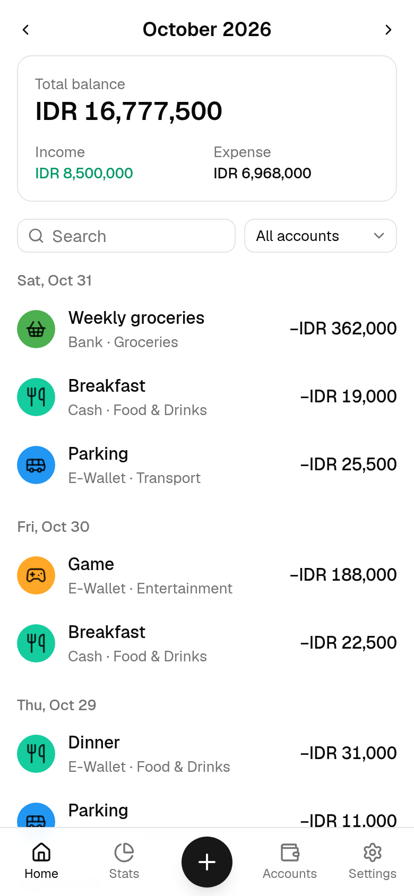
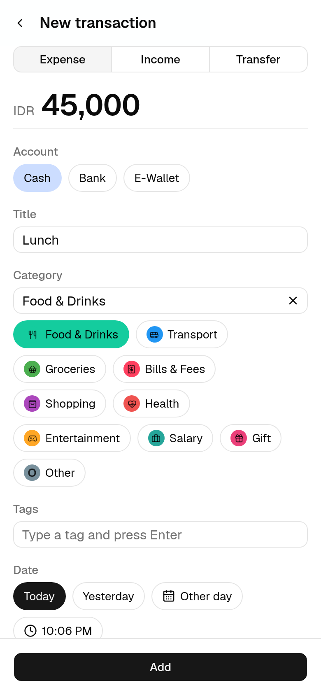
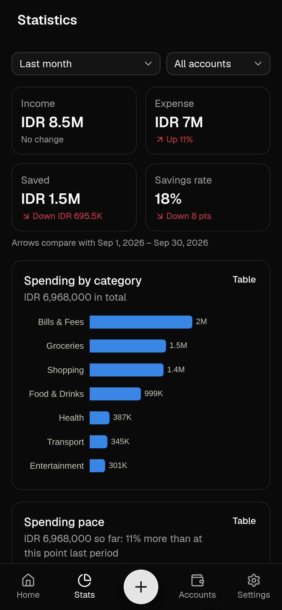
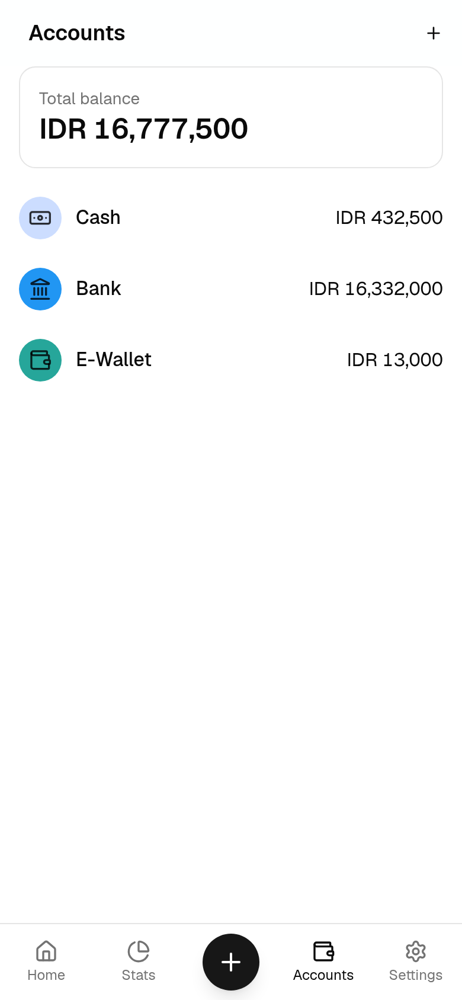

<p align="center">
  
</p>

<h1 align="center">mtWallet</h1>

<p align="center">
  A small personal finance app, based on Ivy Wallet's features.<br>
  Runs in the browser and can sync to your own Google Sheet.
</p>

<p align="center">
  <a href="https://mtwallet.widyaardianto.com"><strong>Open the app →</strong></a>
</p>

<p align="center">
  <a href="https://mtwallet.widyaardianto.com"></a>
  
  
  
  
</p>

<p align="center">
  
  
  
  
</p>
<p align="center"><sub>Screenshots use made-up demo data.</sub></p>

## About

I liked Ivy Wallet but it's no longer maintained and keeps data only on the phone, so this is a simple
web version of the parts I use, with a Google Sheet as the backup.

The app at [mtwallet.widyaardianto.com](https://mtwallet.widyaardianto.com) is the one I use, and you're
welcome to use it too. Your data stays in your browser and, if you connect one, your own Google Sheet.
To just look around, open it in a private window.

## Features

- Income, expenses and transfers, with categories, tags and notes
- Account balances, with balance adjustments like Ivy Wallet
- A few statistics charts
- Sync with a Google Sheet, which you can also edit
- Import from an Ivy Wallet backup
- Works offline and can be installed on your phone
- Light and dark theme

## Repository

| Folder | What |
| --- | --- |
| `frontend/` | The app: React, Vite, Tailwind, shadcn/ui, Dexie. A static PWA. |
| `auth-service/` | Optional token service (Hono) that keeps users signed in to Google. Runs on Cloudflare Workers, Node or Bun. |
| `wrangler.jsonc` | Cloudflare deployment of both: static app + `/api/*` Worker. |

It's a Bun workspace: run `bun install` once at the root.

```sh
bun run dev        # frontend (Vite, :5173) and auth service (:8787); Vite proxies /api to it
bun run test       # all tests
bun run lint
bun run typecheck
bun run build      # builds frontend/dist
```

## Configuration

**Frontend** – `frontend/.env` (see `frontend/.env.example`):

```
VITE_GOOGLE_CLIENT_ID=<OAuth client ID>.apps.googleusercontent.com
# Where the app is published; `bun run deploy` deploys to this domain on Cloudflare
VITE_APP_URL=https://wallet.example.com

# Filled into the Privacy Policy and Terms of Service at build time
VITE_APP_NAME=Wallet
VITE_LEGAL_OPERATOR=<person or company running this deployment>
VITE_LEGAL_CONTACT_EMAIL=
VITE_LEGAL_GOVERNING_LAW=the Republic of Indonesia
```

The documents themselves are Markdown in `frontend/src/legal/` (`privacy.md`, `terms.md`),
served at `/privacy` and `/terms`. `{{placeholders}}` in them take the values above; the build
warns about empty ones and fails on unknown ones. Update the effective date at the top of a
document whenever you change it. If you deploy a fork, they must describe *your* deployment.

**Auth service** – `auth-service/.dev.vars` locally (see `auth-service/.dev.vars.example`),
secrets or environment variables in production:

| Variable | |
| --- | --- |
| `GOOGLE_CLIENT_ID` | Same client as the frontend |
| `GOOGLE_CLIENT_SECRET` | The client's secret. Never put it in the frontend. |
| `SESSION_SECRET` | Random, ≥ 32 characters (`openssl rand -base64 32`). Changing it signs everyone out. |
| `ALLOWED_ORIGINS` | Optional. Comma-separated origins allowed to call the service; defaults to its own origin. |

### Google Cloud setup

1. Create a project; enable the **Google Sheets API** and **Google Drive API**.
2. Google Auth Platform: audience **External**; data access scope
   `https://www.googleapis.com/auth/drive.file` (the app can only see the sheet it creates).
3. Create a **Web application** client. Add your app's origins (e.g.
   `https://wallet.example.com`, `http://localhost:5173`) as *Authorized JavaScript origins*.
   No redirect URIs are needed.
4. Publish the app (**In production**). In *Testing*, Google expires refresh tokens after 7 days,
   so users would have to sign in weekly.

## How sign-in works

- **With the auth service** the user signs in once per device. The popup returns an authorization
  code; the service exchanges it, keeps the refresh token in an encrypted, HttpOnly, SameSite=Strict
  cookie (nothing is stored server-side), and hands the app a fresh access token whenever needed.
  The app still calls Google APIs directly; no user data passes through the service.
- **Without it** (a static deployment, missing configuration, a platform limit or an outage) the app
  falls back to browser-only sign-in: an access token for about an hour, then a "Sign in" tap.
  The app says when this happens and switches back once the service answers again.

## Deploying

**Cloudflare (Workers with static assets).** Free tier is plenty: static files don't count
against the Worker's daily request limit, so the app keeps loading even if the limit is reached.

```sh
bunx wrangler secret put GOOGLE_CLIENT_ID
bunx wrangler secret put GOOGLE_CLIENT_SECRET
bunx wrangler secret put SESSION_SECRET
bun run deploy          # builds, then deploys to the domain in VITE_APP_URL (its zone must be on Cloudflare)
```

**Your own server (Node 23+ or Bun).** One process serves the app and the service:

```sh
bun run build
GOOGLE_CLIENT_ID=… GOOGLE_CLIENT_SECRET=… SESSION_SECRET=… PORT=8787 bun run start
```

Behind a reverse proxy, pass the original `Host` header through (or set `ALLOWED_ORIGINS`):
the service compares it with the request's `Origin`. Google requires HTTPS except on localhost.

**Inside an existing Node server**, e.g. Express:

```ts
import { getRequestListener } from '@hono/node-server'
import { BASE_PATH, createApp } from 'wallet-auth-service'

const auth = getRequestListener(createApp(process.env).fetch)
app.all(`${BASE_PATH}/*`, (req, res) => auth(req, res))
```

**Static hosting only** (any CDN): deploy `frontend/dist` with SPA fallback to `index.html`.
Everything works; users sign in again every hour.

## Credits

Inspired by [Ivy Wallet](https://github.com/Ivy-Apps/ivy-wallet), an open-source money manager,
and compatible with its backups. Not affiliated with or endorsed by the Ivy Wallet project.
